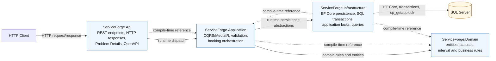
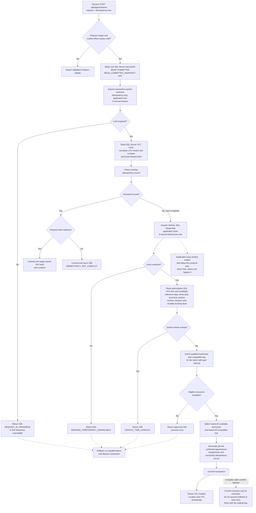

# ServiceForge System Design

## Overview and scope

ServiceForge is a backend-only ASP.NET Core Web API for P0 automotive service scheduling across
multiple dealerships. A customer books an owned vehicle, service type, dealership, and explicit-offset
start time. The system validates the local operating window, selects one qualified technician and
one compatible service bay, prevents conflicts, and supports durable idempotent retries.

P0 includes five REST endpoints, confirmed fully assigned appointments, reference-data reads, SQL
Server persistence, and the approved concurrency protocol. Authentication, frontend applications,
notifications, cancellation/rescheduling workflows, microservices, message queues, and other P1
capabilities are excluded.

Authoritative requirements are in the [feature specification](../specs/001-service-booking/spec.md),
the [constitution](../.specify/memory/constitution.md), and the approved [implementation tasks](../specs/001-service-booking/tasks.md).

## Architecture

This diagram separates the runtime request path from compile-time dependency direction. The API
composes Application and Infrastructure, while Domain remains independent of both presentation and
infrastructure. Infrastructure owns SQL Server and EF Core concerns; Application owns use-case
orchestration through abstractions.

The four production projects are:

- **Api** — hosts ASP.NET Core, maps the five routes, formats Problem Details, exposes Development
  OpenAPI, and composes dependency injection.
- **Application** — contains MediatR commands and queries, validators, booking orchestration,
  allocation rules, idempotency identity, and application abstractions.
- **Domain** — contains entities, statuses, and interval concepts independent of ASP.NET Core,
  EF Core, and SQL Server.
- **Infrastructure** — contains EF Core mappings, SQL Server transactions and application locks,
  queries, persistence, the authoritative SQL clock, migrations, and deterministic reference-data
  seeding.

## Booking data flow

This workflow reflects the handler and infrastructure order: syntax is checked before the
transaction, the idempotency lock and lookup happen first, matching replay and conflict short-circuit
without resource locks, and new or expired requests acquire Vehicle then Dealership locks before
mutable booking validation. Failures roll back through the transaction lifecycle, while a commit
exception remains an uncertain outcome rather than proof of rollback. The application-lock protocol
does not protect direct SQL writers that bypass the application.

1. `POST /api/appointments` validates the request shape and required `Idempotency-Key`.
2. The application parses the explicit-offset ISO 8601 start and derives a typed canonical request
   identity using the normalized UTC instant.
3. One SQL Server transaction begins at `READ COMMITTED`; the database is configured with
   `READ_COMMITTED_SNAPSHOT OFF`.
4. Transaction-owned exclusive application locks are acquired in order: **Idempotency Key → Vehicle
   → Dealership**. Each lock has a five-second timeout.
5. An unexpired matching idempotency record is replayed immediately without vehicle/dealership locks.
   A mismatched request returns `IDEMPOTENCY_KEY_CONFLICT`.
6. New or expired requests obtain fresh SQL Server UTC after the required locks, then revalidate
   ownership, reference data, time rules, conflicts, and resource availability.
7. The lowest-ID available qualified technician and compatible bay are selected independently.
8. One Confirmed, Assigned appointment and its successful idempotency response are persisted and
   committed atomically.
9. The API returns `201 Created`, a `Location` header, assigned resource IDs, and UTC timestamps.

The full workflow and error mapping are documented in the [implementation plan](../specs/001-service-booking/plan.md)
and [API contract](../specs/001-service-booking/contracts/api.md).

## Data model

The reviewed Code First model contains exactly ten application tables:

`Customer`, `Vehicle`, `Dealership`, `ServiceType`, `Technician`, `ServiceBay`,
`TechnicianQualification`, `BayServiceCompatibility`, `Appointment`, and `IdempotencyRecord`.

Composite foreign keys enforce vehicle ownership and dealership resource boundaries. Appointment
timestamps use `datetime2(7)` UTC values. Appointment-to-idempotency storage is at most one current
record per appointment through a unique filtered index. The complete schema is in the
[data model](../specs/001-service-booking/data-model.md).

Reference data is deterministic EF Core `HasData` included in the reviewed migration
`20261101173028_InitialCreate`; the API does not auto-migrate or run a separate startup seed.

## Technology choices and rationale

- ASP.NET Core and C# provide the backend HTTP host.
- Clean Architecture keeps domain rules independent of SQL Server and HTTP concerns.
- MediatR provides CQRS command/query dispatching without coupling handlers to the API.
- EF Core SQL Server provides Code First mappings, reviewed migrations, and DbContext as Unit of Work.
- SQL Server application locks provide explicit transaction-scoped serialization for vehicle,
  dealership, and idempotency resources.
- Real local SQL Server is the approved integration-test engine through
  `SERVICEFORGE_TEST_SQLSERVER_CONNECTION`; Testcontainers remains optional when explicitly approved
  and available.
- xUnit and WebApplicationFactory provide unit and HTTP integration coverage.

The technology and governance rationale is further recorded in [ADRs 001–007](../docs/adr/).

## Concurrency and transaction design

The global lock order prevents lock-order inversions between idempotency, vehicle, and dealership
resources. Locks are transaction-owned and released with transaction completion. Vehicle,
technician, and bay intervals use half-open overlap rules, so exact end-to-start adjacency is valid.

The application revalidates mutable facts after locks are acquired. It does not use automatic
server-side transaction retries. A deadlock victim or vehicle/dealership lock failure maps to the
approved temporary-unavailability response; an idempotency lock timeout maps to
`REQUEST_IN_PROGRESS`.

The lock protocol protects integrity only for writers that follow it. Direct database writes can
bypass application locks, and an artificial SQL deadlock has not been induced by the test suite.

## Idempotency design

`Idempotency-Key` is globally scoped and retained for 24 hours from creation. Request identity uses
typed customer, vehicle, dealership, and service-type IDs plus the normalized UTC start instant, so
JSON property order and equivalent offsets do not change identity.

Matching unexpired requests replay the stored successful body and `Location`. Different payloads
using an unexpired key return `IDEMPOTENCY_KEY_CONFLICT`. Expired-key replacement preserves the
original appointment and replaces the record atomically only when the new transaction succeeds.

## Observability strategy

### Currently implemented

- ASP.NET Core configuration contains default logging levels.
- API errors expose RFC 9457 Problem Details with machine-readable business codes.
- OpenAPI is available at `/openapi/v1.json` in the Development environment.
- Test and acceptance evidence is recorded in the AI development log and acceptance matrix.

### Not currently implemented

The application does not currently add explicit structured booking logs, correlation IDs, metrics,
distributed tracing, health-check endpoints, or dependency dashboards. The design does not claim
those capabilities.

### Production improvement direction

If production observability is later approved, it should measure booking outcome and latency by
approved business code, lock wait and timeout counts by lock kind, transaction/deadlock failures,
idempotency replay/conflict rates, SQL dependency health, and API request correlation. Sensitive
request bodies, credentials, and full connection strings must not be logged. These are future
operational improvements, not part of this P0 implementation.

## AI-assisted design and engineering process

The repository uses GitHub Spec Kit artifacts as the requirements-to-task chain. The owner approved
the constitution, feature specification, architecture, data model, API contract, ADRs, and bounded
implementation batches before code changes were made.

Codex was directed through bounded tasks and was required to preserve approved scope, report
commands and evidence, and stop on conflicts. Generated code and tests were reviewed against the
approved documents and executed with unit, HTTP, and real SQL Server verification. The retrospective
submission audit identified the stale post-lock clock, permissive timestamp parsing, governance
wording conflict, and missing OpenAPI execution test. Corrective Batch R1 addressed those four
findings only and recorded its actual verification in the [AI development log](../docs/ai-development-log.md).

Final engineering quality remains owned by the project owner and reviewers; AI assistance does not
replace approval, code review, security review, or executed test evidence.

## Known limitations and design tradeoffs

- The current verified environment is Windows with .NET 10 and local SQL Server. Complete macOS/Linux
  execution is unverified.
- Docker is not required by the approved local test path and is not configured.
- Direct database writers can bypass the application lock protocol.
- No artificial SQL deadlock has been induced.
- Authentication and authorization are outside P0; the request-supplied customer identity is used for
  ownership validation.
- Operational observability beyond Problem Details, configuration logging, and test evidence remains
  future work.

## Related artifacts

- [Feature specification](../specs/001-service-booking/spec.md)
- [Implementation plan](../specs/001-service-booking/plan.md)
- [Data model](../specs/001-service-booking/data-model.md)
- [API contract](../specs/001-service-booking/contracts/api.md)
- [Acceptance traceability](../docs/acceptance-traceability.md)
- [Architecture decisions](../docs/adr/)
- [Reviewer guide](./REVIEWER-GUIDE.md)
